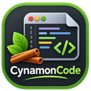

<p align="center">
  
</p>

<h1 align="center">CynamonCode</h1>

<p align="center">
  <strong>A lightweight, native text and code editor for Linux.</strong><br>
  Tabs, syntax highlighting and convenient search — no suggestions, no code checking, no distractions.
</p>

<p align="center">
  <a href="https://github.com/fe-li/CynamonCode/releases/latest"></a>
  <a href="https://github.com/fe-li/CynamonCode/actions/workflows/ci.yml"></a>
  <a href="LICENSE"></a>
</p>

<p align="center"><strong>English</strong> · <a href="README.pl.md">Polski</a></p>

<p align="center">
  <a href="https://github.com/fe-li/CynamonCode/releases/latest"><strong>⬇ Download the .deb package</strong></a> ·
  <a href="#installation">Installation</a> ·
  <a href="#features">Features</a> ·
  <a href="#building-from-source">Building</a>
</p>

| Light theme with the file panel | Dark theme and two views |
|---|---|
|  |  |

## Features

- **Tabs and two views** — move a tab to the second view or clone the same document next to it.
- **Syntax highlighting for 12 languages** — C/C++, Python, Java, JavaScript, HTML, CSS, PHP, SQL, JSON, XML, Bash and plain text; light and dark theme.
- **Find and replace** — match case, whole words, regular expressions; also across all open files. “Replace all” is undone with a single Ctrl+Z.
- **Safe file handling** — atomic saving, line endings and BOM preserved, a warning when another program changes the file; non-UTF-8 files are refused instead of being silently damaged.
- **File panel and session** — folder tree with a name filter; after a restart your open files and cursor positions come back.
- **Keyboard** — a configurable shortcut for every menu command, Ctrl+Tab between tabs, F8 between views, F1 for help.
- **Automatic indentation** — after `{` and HTML tags; tabs or spaces, whatever the file already uses.
- **Desktop integration** — menu entry, “Open With” and, on request, default application for HTML, CSS, JS, PHP and other types (only for your account, reversible).
- **Polish user interface** with built-in help.

### What it deliberately does not do

No code completion or suggestion lists, no parameter hints, no syntax checking or “error” underlines, no LSP, no running or compiling of files, no debugger, no AI assistants, no telemetry and no network connections. CynamonCode highlights syntax — you do the writing. This is a permanent rule of the project, enforced by tests (`tests/gui/tst_editor_no_suggestions.cpp`).

## Installation

Package for **Linux Mint 22.x** and **Ubuntu 24.04** (or newer), 64-bit.

1. Download `cynamoncode_1.0.0_amd64.deb` from the [latest release](https://github.com/fe-li/CynamonCode/releases/latest).
2. Double-click the file and choose “Install Package” — or in a terminal:

   ```bash
   sudo apt install ./cynamoncode_1.0.0_amd64.deb
   ```

   `apt` installs the missing libraries (Qt 6, QScintilla) automatically.
3. Start it from the menu: **Accessories → CynamonCode**, or run `cynamoncode file.txt` in a terminal.

Uninstall: `sudo apt remove cynamoncode`. The package does not change default applications or system settings. Release checksums are in `SHA256SUMS` (`sha256sum -c SHA256SUMS`).

The user interface is in Polish; the main commands are in the menus *Plik* (File), *Edycja* (Edit), *Szukaj* (Search), *Widok* (View), *Język* (Language), *Ustawienia* (Settings) and *Pomoc* (Help).

## Building from source

Requirements (Linux Mint 22.x / Ubuntu 24.04): C++20, CMake ≥ 3.21, Ninja, Qt 6 (Core, Gui, Widgets, Test), QScintilla 2 for Qt 6. System packages:

```bash
sudo apt install build-essential cmake ninja-build git pkg-config \
  qt6-base-dev qt6-tools-dev qt6-tools-dev-tools qt6-qpa-plugins \
  libqscintilla2-qt6-dev libgl-dev
```

Build, test and run:

```bash
bash scripts/bootstrap-mint.sh          # checks dependencies; installs only with --install after confirmation
bash scripts/build.sh                   # Debug → build/
bash scripts/test.sh                    # ctest (GUI tests without a display: QT_QPA_PLATFORM=offscreen)
./build/cynamoncode
```

The same without scripts:

```bash
cmake -S . -B build -G Ninja -DCMAKE_BUILD_TYPE=Debug -DBUILD_TESTING=ON
cmake --build build --parallel
QT_QPA_PLATFORM=offscreen ctest --test-dir build --output-on-failure
```

The `.deb` package and the source archive (CPack):

```bash
bash scripts/build.sh release
cpack --config build-release/CPackConfig.cmake -B build-release/pakiety
cpack --config build-release/CPackSourceConfig.cmake -B build-release/pakiety
```

CMake presets: `debug` (directory `build/`), `release` (`build-release/`) and the test preset `debug-offscreen`. Point to a custom QScintilla installation with `-DQScintillaQt6_ROOT=<directory>`. The project website is in `website/` (`bash scripts/build-website.sh`).

### Common problems

- **“Could not find the Qt platform plugin”** — `qt6-qpa-plugins` is missing. Without a display (SSH, CI) run GUI tests with `QT_QPA_PLATFORM=offscreen` (`scripts/test.sh` and the `debug-offscreen` preset do this).
- **“Failed to find required Qt component Gui” / WrapOpenGL** — install `libgl-dev`.
- **“Could NOT find XKB”** — an optional Qt6Gui dependency; the build works without it (`libxkbcommon-dev` removes the message).
- **`Qsci/qsciscintilla.h` not found** — `libqscintilla2-qt6-dev` is missing; the project requires the Qt 6 variant, the Qt 5 variant is not used.
- **Polish labels in the file and font dialogs** — package `qt6-translations-l10n` (recommended by the `.deb` package).

## Repository layout

| Path | Purpose |
|---|---|
| `src/` | code: `domain/`, `services/`, `controllers/` (no GUI), `editor/`, `ui/`, `app/` |
| `tests/` | Qt Test/CTest tests: `unit/`, `gui/`, `packaging/` |
| `cmake/` | QScintilla Qt6 detection, install rules, `.deb` package (CPack) |
| `packaging/` | `.desktop` entry, AppStream metadata, `man` page, `copyright` file |
| `resources/` | icons and source logo |
| `scripts/` | dependency check, build, tests, icons, website |
| `website/` | project website (Polish and English) |
| `.github/workflows/` | CI: build and tests on Ubuntu 24.04 |
| `CHANGELOG.md` | change history (in Polish) |

## License

Copyright © 2026 Kamil Feliszewski

CynamonCode is free software: you can redistribute it and/or modify it under the terms of the **GNU General Public License as published by the Free Software Foundation, either version 3 of the License, or (at your option) any later version** (SPDX: `GPL-3.0-or-later`). It is distributed without any warranty. Full text: [`LICENSE`](LICENSE).

The program uses Qt 6 (LGPLv3) and QScintilla (GPLv3). The project is not affiliated with Linux Mint or the Cinnamon desktop.
