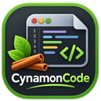

<p align="center">
  
</p>

<h1 align="center">CynamonCode</h1>

<p align="center">
  <strong>Lekki, natywny edytor tekstu i kodu dla Linuksa.</strong><br>
  Karty, kolorowanie składni i wygodne wyszukiwanie — bez podpowiedzi, bez sprawdzania kodu, bez rozpraszania.
</p>

<p align="center">
  <a href="https://github.com/fe-li/CynamonCode/releases/latest"></a>
  <a href="https://github.com/fe-li/CynamonCode/actions/workflows/ci.yml"></a>
  <a href="LICENSE"></a>
</p>

<p align="center"><a href="README.md">English</a> · <strong>Polski</strong></p>

<p align="center">
  <a href="https://github.com/fe-li/CynamonCode/releases/latest"><strong>⬇ Pobierz pakiet .deb</strong></a> ·
  <a href="#instalacja">Instalacja</a> ·
  <a href="#funkcje">Funkcje</a> ·
  <a href="#budowanie-ze-źródeł">Budowanie</a>
</p>

| Motyw jasny z panelem plików | Motyw ciemny i dwa widoki |
|---|---|
|  |  |

## Funkcje

- **Karty i dwa widoki** — przenoszenie karty do drugiego widoku albo klon tego samego dokumentu obok.
- **Kolorowanie składni 12 języków** — C/C++, Python, Java, JavaScript, HTML, CSS, PHP, SQL, JSON, XML, Bash i zwykły tekst; motyw jasny i ciemny.
- **Znajdź i zamień** — wielkość liter, całe wyrazy, wyrażenia regularne; także we wszystkich otwartych plikach. „Zamień wszystkie” cofa jedno Ctrl+Z.
- **Bezpieczne pliki** — atomowy zapis, zachowane końce linii i BOM, ostrzeżenie o zmianach dokonanych przez inny program; pliki spoza UTF-8 nie są otwierane, zamiast być po cichu psute.
- **Panel plików i sesja** — drzewo folderu z filtrem; po ponownym uruchomieniu wracają otwarte pliki i pozycja kursora.
- **Klawiatura** — konfigurowalny skrót każdego polecenia menu, Ctrl+Tab między kartami, F8 między widokami, F1 — pomoc.
- **Automatyczne wcięcia** — po `{` i znacznikach HTML; tabulatory lub spacje, tak jak w pliku.
- **Integracja z systemem** — wpis w menu, „Otwórz za pomocą” i na życzenie domyślny program dla HTML, CSS, JS, PHP i innych typów (tylko dla Twojego konta, odwracalnie).
- **Interfejs po polsku**, pomoc w programie.

### Czego tu nie ma — celowo

Autouzupełniania i list podpowiedzi, podpowiedzi parametrów, sprawdzania składni i podkreślania „błędów”, LSP, uruchamiania i kompilowania plików, debuggera, asystentów AI, telemetrii i połączeń z siecią. CynamonCode koloruje składnię — piszesz Ty. To stała zasada projektu, pilnowana testami (`tests/gui/tst_editor_no_suggestions.cpp`).

## Instalacja

Pakiet dla **Linux Mint 22.x** i **Ubuntu 24.04** (lub nowszych), 64-bit.

1. Pobierz `cynamoncode_1.0.0_amd64.deb` z [najnowszego wydania](https://github.com/fe-li/CynamonCode/releases/latest).
2. Kliknij plik dwukrotnie i wybierz „Zainstaluj pakiet” — albo w terminalu:

   ```bash
   sudo apt install ./cynamoncode_1.0.0_amd64.deb
   ```

   Brakujące biblioteki (Qt 6, QScintilla) `apt` doinstaluje sam.
3. Uruchom z menu: **Akcesoria → CynamonCode**, albo `cynamoncode plik.txt` w terminalu.

Odinstalowanie: `sudo apt remove cynamoncode`. Pakiet nie zmienia domyślnych programów ani ustawień systemu. Sumy kontrolne plików wydania są w `SHA256SUMS` (`sha256sum -c SHA256SUMS`).

## Budowanie ze źródeł

Wymagania (Linux Mint 22.x / Ubuntu 24.04): C++20, CMake ≥ 3.21, Ninja, Qt 6 (Core, Gui, Widgets, Test), QScintilla 2 dla Qt 6. Pakiety systemowe:

```bash
sudo apt install build-essential cmake ninja-build git pkg-config \
  qt6-base-dev qt6-tools-dev qt6-tools-dev-tools qt6-qpa-plugins \
  libqscintilla2-qt6-dev libgl-dev
```

Budowanie, testy i uruchomienie:

```bash
bash scripts/bootstrap-mint.sh          # sprawdza zależności; instaluje tylko z --install i po potwierdzeniu
bash scripts/build.sh                   # Debug → build/
bash scripts/test.sh                    # ctest (testy GUI bez ekranu: QT_QPA_PLATFORM=offscreen)
./build/cynamoncode
```

To samo bez skryptów:

```bash
cmake -S . -B build -G Ninja -DCMAKE_BUILD_TYPE=Debug -DBUILD_TESTING=ON
cmake --build build --parallel
QT_QPA_PLATFORM=offscreen ctest --test-dir build --output-on-failure
```

Pakiet `.deb` i archiwum źródeł (CPack):

```bash
bash scripts/build.sh release
cpack --config build-release/CPackConfig.cmake -B build-release/pakiety
cpack --config build-release/CPackSourceConfig.cmake -B build-release/pakiety
```

Presety CMake: `debug` (katalog `build/`), `release` (`build-release/`), testowy `debug-offscreen`. Niestandardową instalację QScintilli wskażesz przez `-DQScintillaQt6_ROOT=<katalog>`. Strona www programu jest w `website/` (`bash scripts/build-website.sh`).

### Typowe problemy

- **„Could not find the Qt platform plugin”** — brak `qt6-qpa-plugins`. Bez ekranu (SSH, CI) testy GUI uruchamiaj z `QT_QPA_PLATFORM=offscreen` (robi to `scripts/test.sh` i preset `debug-offscreen`).
- **„Failed to find required Qt component Gui” / WrapOpenGL** — zainstaluj `libgl-dev`.
- **„Could NOT find XKB”** — opcjonalna zależność Qt6Gui; budowanie działa bez niej (`libxkbcommon-dev` usuwa komunikat).
- **`Qsci/qsciscintilla.h` not found** — brak `libqscintilla2-qt6-dev`; projekt wymaga wariantu Qt 6, wariant Qt 5 nie jest używany.
- **Polskie napisy w oknach wyboru pliku i czcionki** — pakiet `qt6-translations-l10n` (pakiet `.deb` go zaleca).

## Struktura repozytorium

| Ścieżka | Przeznaczenie |
|---|---|
| `src/` | kod: `domain/`, `services/`, `controllers/` (bez GUI), `editor/`, `ui/`, `app/` |
| `tests/` | testy Qt Test/CTest: `unit/`, `gui/`, `packaging/` |
| `cmake/` | wykrywanie QScintilla Qt6, reguły instalacji, pakiet `.deb` (CPack) |
| `packaging/` | wpis `.desktop`, metadane AppStream, strona `man`, plik `copyright` |
| `resources/` | ikony i logo źródłowe |
| `scripts/` | sprawdzanie zależności, budowanie, testy, ikony, strona www |
| `website/` | strona www (PL i EN) |
| `.github/workflows/` | CI: budowanie i testy na Ubuntu 24.04 |
| `CHANGELOG.md` | historia zmian |

## Licencja

Copyright © 2026 Kamil Feliszewski

CynamonCode jest wolnym oprogramowaniem: możesz je rozpowszechniać i modyfikować na warunkach **GNU General Public License w wersji 3 lub (według Twojego wyboru) dowolnej późniejszej** (SPDX: `GPL-3.0-or-later`). Program jest rozpowszechniany bez jakiejkolwiek gwarancji. Pełny tekst: [`LICENSE`](LICENSE).

Program korzysta z Qt 6 (LGPLv3) i QScintilla (GPLv3). Projekt nie jest związany z Linux Mint ani środowiskiem Cinnamon.
